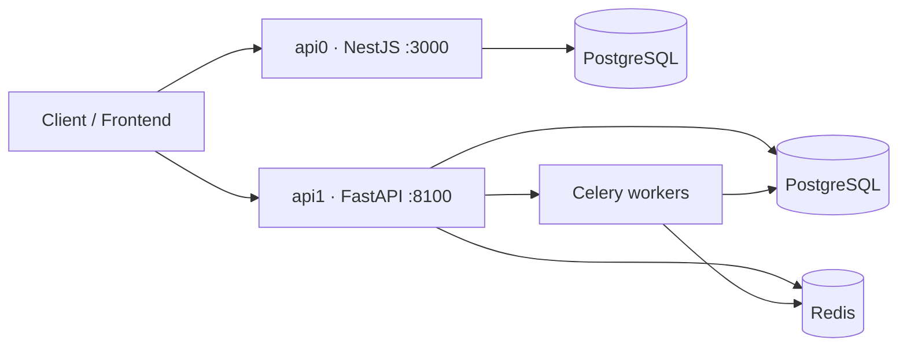

<div align="center">

# Backend Apps

**Deux APIs de production, deux stacks, un même objectif : livrer vite et proprement.**

[](https://nestjs.com)
[](https://fastapi.tiangolo.com)
[](https://www.postgresql.org)
[](https://docs.docker.com/compose/)

</div>

---

## Aperçu

Ce dépôt regroupe deux backends autonomes, prêts pour le développement et la production :

| Dossier          | Stack                                          | Rôle                                                     | Port   |
| ---------------- | ---------------------------------------------- | -------------------------------------------------------- | ------ |
| [`api0/`](api0/) | **NestJS 12** · TypeScript · Drizzle ORM       | Auth JWT complète, RBAC, mail, API documentée            | `3000` |
| [`api1/`](api1/) | **FastAPI** · Python 3.13 · SQLAlchemy 2 async | Plateforme complète : auth, billing, jobs, observabilité | `8100` |

Les deux projets embarquent PostgreSQL, Docker Compose, des migrations, des tests et une documentation OpenAPI interactive.

---

## Architecture



- **api0** reste volontairement minimal et focalisé : authentification, utilisateurs, santé.
- **api1** est une base « batteries included » : multi-tenant, paiements Stripe, files de tâches, recherche, IA, WebSockets, metrics.

---

## api0 — NestJS + Drizzle

Template NestJS avec authentification JWT solide et Drizzle ORM.

**Inclus :** access + refresh tokens (rotation, hash en base, nettoyage planifié), RBAC `USER`/`ADMIN`, cookies httpOnly, rate limiting, email SMTP optionnel (Handlebars), Swagger, Pino, Helmet, validation Zod/class-validator.

```bash
cd api0
pnpm install
pnpm run db:up        # PostgreSQL via Docker
pnpm run db:push      # applique le schéma
pnpm run start:dev    # http://localhost:3000
```

- Swagger : `http://localhost:3000/docs` (en développement)
- Santé : `GET /health` · Auth : `/auth/*` · Utilisateurs : `/user/*`
- Migrations : `pnpm run db:generate` puis `pnpm run db:migrate`
- Tests : `pnpm run test` et `pnpm run test:e2e`

---

## api1 — FastAPI + PostgreSQL

Boilerplate FastAPI async, complet et prêt à déployer.

**Inclus :** JWT rotation, OTP, magic link, TOTP, OAuth2 (Google/GitHub), passkeys WebAuthn, RBAC, organisations, Stripe, Celery, notifications, webhooks, feature flags, uploads S3/local, recherche, audit, IA (Anthropic/OpenAI), SQLAdmin, OpenTelemetry/Sentry/Prometheus.

```bash
cd api1
just setup            # uv sync + crée .env
just up               # PostgreSQL + Redis + API via Docker
just migrate          # migrations Alembic
just seed             # données de démonstration
```

- API : `http://localhost:8100/api/`
- Swagger : `http://localhost:8100/docs` · ReDoc : `/redoc` · Admin : `/admin`
- Métriques : `http://localhost:8100/metrics`
- Tests : `just test`, `just test-unit`, `just test-integration`, `just test-e2e`
- Qualité : `just check` (ruff + mypy)

---

## Démarrage express

```bash
# api0
cd api0 && pnpm install && cp .env.example .env && pnpm run db:up && pnpm run start:dev

# api1
cd api1 && just setup && just up && just migrate && just seed

# ou tout-en-un côté api1
cd api1 && just quickstart
```

> **Attention aux ports.** Les deux projets exposent PostgreSQL sur `5432` par défaut. Lancez-les l'un après l'autre, ou modifiez `POSTGRES_PORT` dans `api1/.env` (ex. `5433`).

---

## Configuration

Chaque projet fournit un `.env.example` documenté. Points sensibles :

- `SECRET_KEY` et `JWT_SECRET_KEY` : minimum 32 caractères, valeurs uniques par environnement.
- `DATABASE_URL` : adaptez utilisateur, mot de passe et base.
- `CORS` / `WHITELIST` : limitez aux origines du frontend.
- SMTP (api0), Resend/Stripe/OAuth/IA (api1) : facultatifs, désactivés sans clé.

Ne committez jamais de `.env` ni de secrets.

---

## Documentation

| Projet | Documentation                                                                              |
| ------ | ------------------------------------------------------------------------------------------ |
| api0   | [`api0/README.md`](api0/README.md) · [`AGENTS.md`](api0/AGENTS.md)                         |
| api1   | [`api1/README.md`](api1/README.md) · [`docs/`](api1/docs/) · [`AGENTS.md`](api1/AGENTS.md) |

---

<div align="center">
<sub>NestJS · FastAPI · PostgreSQL · Docker — prêt pour le hackathon.</sub>
</div>
